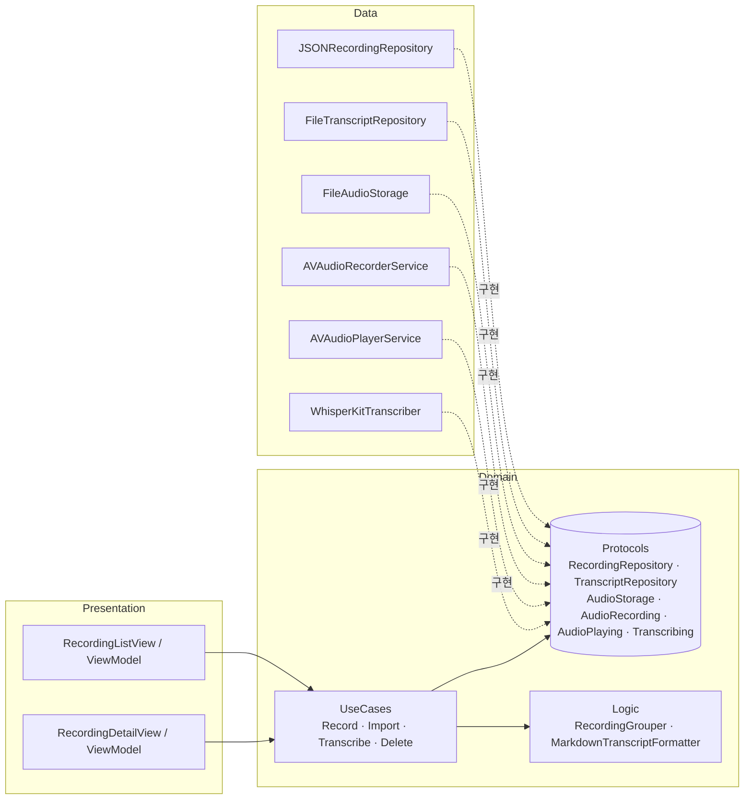

# 말뭉치 (Malmungchi) — 녹음 기반 세컨드 브레인

> **말뭉치**는 언어학에서 AI가 학습하는 텍스트 모음(corpus)을 뜻합니다. 하루하루 한 말이 쌓여 나만의 말뭉치가 되고, AI가 그걸로 나를 이해합니다.

하루 동안의 녹음(직접 녹음, 통화 녹음, 음성 메모)을 **기기 안에서** 받아쓰고, LLM이 일기·할 일·결정 사항·사람/프로젝트 위키로 정리해 주는 iOS 앱입니다.

> 지금은 **1주 차 MVP** 단계입니다: 녹음·가져오기 → 온디바이스 받아쓰기 → 날짜별 기록 → 재생(문장을 누르면 그 위치부터) → 옵시디언 호환 마크다운 저장.

## 왜 만드나

통화와 미팅이 많은데, 들은 내용과 할 일을 다시 정리하는 데 시간이 많이 듭니다. 녹음 → 받아쓰기 → 요약 → 할 일·문서로 바꾸는 과정을 매일 자동으로 돌리는 것이 목표입니다.

## 구조



- **Domain**은 다른 계층을 모릅니다. 구체 타입은 `AppContainer`(Composition Root)에서만 조립합니다.
- **생성자 주입 DI**로 연결하고, 테스트에서는 모든 저장소·녹음기·받아쓰기 엔진을 **Fake**로 바꿉니다.
- **받아쓰기는 WhisperKit**으로 기기 안에서 처리합니다. 오디오는 기기 밖으로 나가지 않습니다.

## 저장 위치

앱 `Documents/Malmungchi/` 아래에 저장되고, 파일 앱에서 보입니다.

```
Malmungchi/
├── recordings.json        # 녹음 메타데이터
├── Audio/<id>.m4a
└── Transcripts/
    ├── <id>.json          # 앱용
    └── <id>.md            # 옵시디언·LLM 위키용 (front matter + [mm:ss] 구간)
```

`recordings.json`이 손상되면 조용히 버리지 않고 `recordings.corrupt-<timestamp>.json`으로 백업한 뒤 알립니다.

## 실행

```bash
brew install xcodegen
xcodegen generate
open Malmungchi.xcodeproj
```

- iOS 17 이상, Xcode 16 이상 (Swift Testing 사용)
- 처음 받아쓸 때 Whisper 모델(약 600MB)을 내려받습니다. 개발 중에는 `WhisperKitTranscriber(modelName: "base")`로 바꾸면 빠릅니다.
- 시뮬레이터에서도 돌아가지만, 받아쓰기 속도는 실제 기기(Neural Engine)에서 확인해야 합니다.

## 테스트

```bash
xcodebuild test -project Malmungchi.xcodeproj -scheme Malmungchi \
  -destination "platform=iOS Simulator,name=iPhone 16"
```

| 대상 | 내용 |
|---|---|
| UseCase | 가져오기, 녹음 시작·종료, 받아쓰기 상태 전이(pending → inProgress → completed/failed), 삭제 |
| Logic | 서울 시각 기준 날짜 묶기, 타임스탬프 형식, 마크다운 출력 |
| Data | JSON 왕복, 손상 파일 백업, 받아쓰기 JSON·마크다운 저장·삭제 |
| ViewModel | 자동 받아쓰기, 녹음 흐름, 에러 표시, 삭제, 재생·이동·문장 탭 재생 |
| Playback | 재생 위치 → 현재 받아쓰기 구간 찾기 |

GitHub Actions가 `main` push와 PR마다 테스트를 돌립니다.

## 로드맵

- [x] **1주:** 녹음·가져오기, 온디바이스 받아쓰기, 저장, 테스트, CI
- [ ] **2주:** LLM 정리 → 하루 일기·할 일·결정 사항, iOS 미리알림 연동, 공유 시트 확장(통화 녹음 바로 보내기)
- [ ] **3주:** 사람·프로젝트 위키 자동 갱신(LLM 위키), 기록 검색·질문(RAG)
- [ ] **4주:** MCP 서버(Claude 앱·Claude Code에서 조회), 데모 영상

## 원칙

- 본인이 참여한 대화만 녹음합니다. 남의 대화를 몰래 녹음하는 것은 불법입니다(통신비밀보호법).
- 오디오와 받아쓰기 원문은 기기에 남고, 2주 차부터 LLM에는 요약에 필요한 텍스트만 보냅니다.
